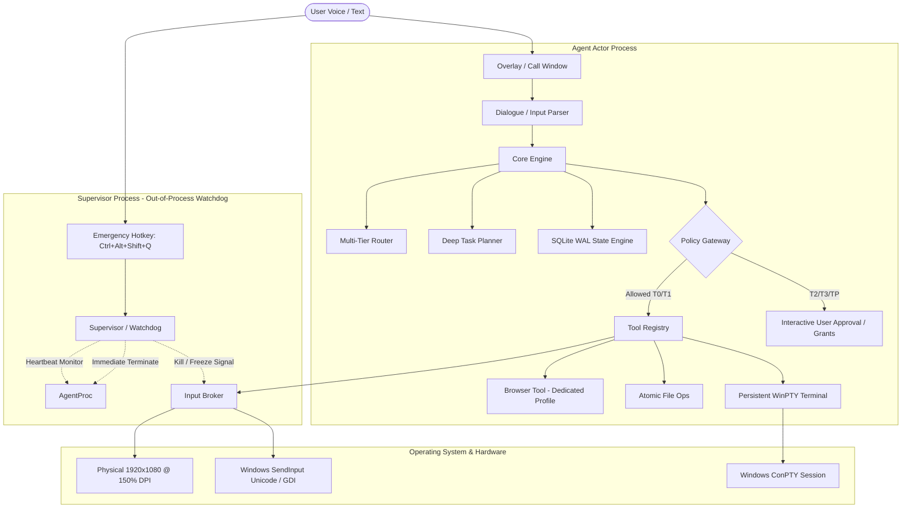

# SYSTEM ARCHITECTURE

**Project**: Antigravity Local Bounded-Autonomy Computer-Operating Agent (v3)  
**Status**: [VERIFIED] Phase 1 Walking Skeleton Active  

---

## 1. Process & Concurrency Model

### Key Components

1. **Supervisor Process (`agent/supervisor/watchdog.py`)**:
   - Runs out-of-process from the agent actor.
   - Listens to global hotkeys (`Ctrl+Alt+Shift+Q` for emergency stop, `Ctrl+Alt+Shift+P` for pause).
   - Monitors heartbeats; can freeze input or forcefully terminate the agent process tree within $<1.0\text{ s}$ stop latency.
2. **Policy Gateway (`agent/policy/gateway.py`)**:
   - The **ONLY** entry point through which tools can interact with the operating system.
   - Enforces risk tiers (T0 Observe, T1 Routine, T2 Elevated, T3 Sensitive, TP Power).
   - Validates provenance: untrusted content (web/OCR/file text) can never originate actions or create Grants.
   - Canonicalizes all paths (symlinks, junctions, 8.3 short names, UNC) before policy evaluation.
   - Blocks catastrophic command patterns and protected windows.
3. **Write-Ahead Log (`agent/core/wal.py`)**:
   - SQLite WAL state machine.
   - Logs `INTENT` record prior to action execution and `COMMITTED` record after programmatic verification.
   - Distinguishes `IDEMPOTENT` from `NON_IDEMPOTENT` steps for crash recovery.
4. **Input Broker (`agent/core/input_broker.py`)**:
   - Single serialized owner of mouse and keyboard.
   - Asserts active foreground window before every keystroke batch (`assert_foreground_window()`).
   - Rejects input directed at protected development windows or password managers.
   - Maps physical coordinates (1920x1080) to logical coordinates (1280x720) across DPI scaling.
5. **Tool Registry & Subsystems**:
   - `browser.py`: Google Chrome launched with a dedicated, isolated agent profile (`%LOCALAPPDATA%\AntigravityAgent\BrowserProfile`).
   - `file_ops.py`: Atomic write operations with cryptographic SHA256 checksums and size verification.
