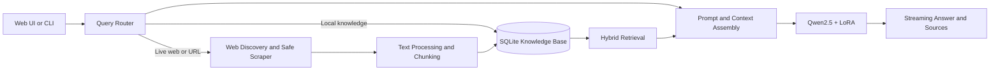

<div align="center">

# Local LLM

### A local AI chat application with web search, retrieval, and evidence-grounded answers

Run a Qwen language model with a fine-tuned LoRA adapter, retrieve relevant web and knowledge-base content, and chat from a browser or terminal.

[](https://www.python.org/)
[](https://flask.palletsprojects.com/)
[](https://huggingface.co/Qwen/Qwen2.5-1.5B-Instruct)

[Portfolio](https://syedalihussainnaqvi.github.io/portfolio/) ·
[LinkedIn](https://www.linkedin.com/in/syedalihussainnaqvi/) ·
[GitHub](https://github.com/syedalihussainnaqvi)

</div>

---

## Overview

**Local LLM** combines local language-model inference with a web retrieval and Retrieval-Augmented Generation (RAG) pipeline. It can fetch and extract web pages, save content to a local SQLite knowledge base, retrieve relevant passages for a question, and show source links with the answer.

The application uses **Qwen2.5-1.5B-Instruct** with a **PEFT LoRA adapter**. RAG provides information at question time; adding pages to the knowledge base does not retrain or modify the model.

### Features

- Local model inference using the Qwen2.5-1.5B-Instruct base model and included LoRA adapter.
- Browser chat with streaming responses and configurable search modes.
- Interactive CLI for chat and knowledge-base management.
- Live web discovery, direct-URL retrieval, and local SQLite RAG.
- Hybrid lexical and dense retrieval with source citations.
- Website scraping with URL validation, redirect checks, and response limits.
- Incremental knowledge-base refresh and document versioning.
- Agent, voice, and desktop-interaction modules.

## How it works



Typical flow:

1. The router selects a local-model, local-knowledge, live-web, or direct-URL path.
2. Retrieved web content is extracted, normalized, and split into chunks.
3. Documents and metadata are stored in SQLite and searched for relevant passages.
4. The selected context and source information are passed to the model.
5. The response is streamed to the user, with citations when available.

## Project layout

```text
src/local_llm/          Application package
  agent/                Agent core, policy, tools, supervisor, and voice
  templates/            Web interface templates
  app.py                Flask application
  cli_chat.py           Interactive chat CLI
  llm_engine.py         Model loading and inference
  rag_pipeline.py       Retrieval and response orchestration
models/adapter/         LoRA adapter and tokenizer files
tests/                  Automated tests
eval/                   Evaluation code and fixtures
docs/                   Architecture, security, and operations guides
scripts/model/          Model download and load-test scripts
dev/scratch/            Manual and experimental scripts
data/                   Local application data and SQLite database
app.py                  Compatibility launcher for the web application
cli_chat.py             Compatibility launcher for the chat CLI
agent_cli.py            Compatibility launcher for the agent CLI
```

## Requirements

- Python 3.10 or later.
- Git and `pip`.
- At least 8 GB of RAM recommended.
- Internet access for the initial base-model download and live web features.
- CPU inference is supported. A compatible CUDA-enabled PyTorch setup can use an NVIDIA GPU.

The base model download is several gigabytes. Actual memory use and inference speed depend on your hardware and PyTorch configuration.

## Installation

Clone the repository and enter its folder:

```powershell
git clone https://github.com/syedalihussainnaqvi/Local-LLM.git
cd Local-LLM
```

Create and activate a virtual environment:

```powershell
python -m venv .venv
.\.venv\Scripts\Activate.ps1
```

Install dependencies:

```powershell
python -m pip install --upgrade pip
python -m pip install -r requirements.txt
```

The base model is loaded from the Hugging Face cache or downloaded as needed on first model load. To download it ahead of time, run:

```powershell
python scripts\model\download_model.py
```

## Configuration

`src/local_llm/config.py` reads supported settings from process environment variables. `.env.example` lists the available settings and example values, but the application does **not** automatically load a `.env` file. Set environment variables in your shell before starting the application.

Example in PowerShell:

```powershell
$env:BASE_MODEL_NAME = "Qwen/Qwen2.5-1.5B-Instruct"
$env:PORT = "5000"
$env:WEB_ACCESS_ENABLED = "true"
$env:SEARCH_PROVIDER = "duckduckgo"
```

Optional search-provider credentials can be set with `BRAVE_API_KEY` or `SERPAPI_API_KEY`. Keep real keys out of source control; do not commit secrets.

## Run the application

### Web interface

From the repository root:

```powershell
python app.py
```

Or use the Windows launcher:

```text
run_web_ui.bat
```

Open [http://127.0.0.1:5000](http://127.0.0.1:5000).

### Chat CLI

```powershell
python cli_chat.py
```

Or use `run_cli.bat` on Windows. The CLI supports:

| Command | Action |
|---|---|
| `/scrape <url>` | Fetch a page and add it to the knowledge base. |
| `/sources` | List stored sources. |
| `/refresh [url]` | Refresh all sources or one source. |
| `/delete <url>` | Remove a source and its chunks. |
| `/mode <auto\|local\|live\|llm>` | Select the query mode. |
| `/web <on\|off>` | Toggle web access. |
| `/clear` | Clear the current conversation history. |
| `exit` or `quit` | Exit the CLI. |

### Agent CLI

The separate agent command-line interface is available through the compatibility launcher:

```powershell
python agent_cli.py --help
```

## Search modes and knowledge base

- **Auto** — lets the query router choose a route.
- **Local KB** — retrieves from previously stored content.
- **Live Web** — discovers and retrieves web content when web access is enabled.
- **LLM Only** — answers without web or local knowledge-base retrieval.
- **Direct URL** — processes a URL included in the prompt.

Use the Web UI or `/scrape <url>` in the CLI to add sources. Content is stored locally in `data/rag_storage.db` by default. Refreshing a source updates its stored version when the page content changes.

## Safety and limitations

- URL fetching validates destinations and redirects to reduce SSRF risk and blocks unsafe network targets.
- Request timeouts and response-size limits help constrain resource use.
- Retrieved page text is treated as untrusted input; website content should not override system instructions.
- Scraping does not bypass CAPTCHAs, login requirements, paywalls, or other access controls.
- Static HTML extraction may return limited content from JavaScript-heavy sites.
- A small language model can produce incorrect answers. Check the cited sources for important information.
- CPU inference may be slow. Speed varies by device, model-loading configuration, and generation settings.

The agent and desktop-control features can perform actions on the local machine. Review permission prompts and project security documentation before enabling or using those features.

## Tests

Install the requirements, then run the test suite from the repository root:

```powershell
python -m pytest tests/ eval/harness/test_walking_skeleton.py -v
```

Some fixtures and manual scripts are under `eval/` and `dev/scratch/`; live or manual scripts are not part of the standard test run.

## Documentation

Project design and operating notes are in [`docs/`](docs/), including:

- [Architecture](docs/ARCHITECTURE.md)
- [Security](docs/SECURITY.md)
- [Testing](docs/TESTING.md)
- [Operations runbook](docs/RUNBOOK.md)
- [Voice features](docs/VOICE.md)

## License

No license is currently included in this repository. Until a license is added, reuse and redistribution permissions are not granted by this project.

## Author

**Syed Ali Hussain Naqvi** · AI Developer

- [Portfolio](https://syedalihussainnaqvi.github.io/portfolio/)
- [LinkedIn](https://www.linkedin.com/in/syedalihussainnaqvi/)
- [GitHub](https://github.com/syedalihussainnaqvi)

---

<div align="center">
Local intelligence · Searchable knowledge · Evidence-aware answers
</div>
